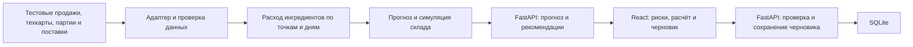

# Coyote Supply — план разработки MVP для команды из двух человек

**Кейс №04 · Умный прогноз закупок · Global Coffee × Coyote**

**Цель.** Управляющий открывает свою точку, видит, какие ингредиенты могут закончиться или быть списаны, понимает причину и сохраняет исправленный черновик закупки.

**Архитектура.** React и TypeScript отвечают за интерфейс. FastAPI проверяет данные, рассчитывает прогноз, формирует предупреждения и сохраняет черновики в SQLite. Данные поступают из версионированного тестового набора через один адаптер. Доступ к Coyote API и способ встраивания в Manager обсуждаются с Coyote отдельно.

**Рабочие предположения.** Два участника и 12–16 рабочих часов на человека. Один локально запускаемый MVP, две синтетические точки с разным спросом и расписанием, 6–8 ингредиентов, 8–12 недель истории. Если времени окажется меньше, сокращаем количество ингредиентов до трёх и сохраняем весь основной сценарий. Формальный регламент судейства и правила публикации нужно получить у организаторов.

## 1. Что именно сдаём

| Требование кейса, стр. 4 | Как реализуем | Как доказываем на защите |
|---|---|---|
| Определять потребность на ближайшие дни | Прогноз расхода ингредиентов по дням для выбранной точки. Продажи напитков переводятся в сырьё через техкарты | Открываем молоко и видим прогноз, запас и даты поставок |
| Предупреждать о возможной нехватке | Календарь расхода и прихода показывает первый день нехватки. Отдельно отмечаем дефицит до ближайшего возможного пополнения | В точке А молока не хватает уже во вторник, а новая закупка приедет в четверг |
| Выявлять излишки и риск списаний | Излишек — остаток выше заданного целевого уровня на конец окна. Риск списания считаем по конкретной партии и её сроку | В карточке сливок показываем ожидаемые 9 л неиспользованной партии и срок |
| Проверять и изменять предлагаемый заказ | Объяснение рекомендации, ручное изменение количества, проверка упаковки, новый итог в ₸ и сохранение | Меняем 24 л на 30 л, сохраняем, обновляем страницу и показываем сохранённое количество |
| Показать прототип на тестовых данных | Экран закупок, карточка ингредиента, редактор черновика. Явная маркировка «Демо-данные» | Чистый запуск на ноутбуке команды с тем же результатом |
| Уточнить, что уже есть у Coyote | Участник А фиксирует ответ и границы интеграции в GitHub Issue | Показываем, какую часть процесса прототип дополняет и на каких данных работает |

**Для Global Coffee.** Один понятный процесс для разных франчайзинговых точек. Спрос, поставки и рекомендации зависят от точки. Интерфейс использует язык управляющего кофейней, дату заказа, дату поставки, литры, килограммы, штуки и тенге. Две тестовые точки можно назвать «Шымкент · демо» и «Алматы · демо», без привязки к конкретным работающим филиалам.

**Для Coyote.** Публично описаны техкарты, складские документы, продажи, выгрузка отчётов и предупреждения о низком остатке. Проверяемая добавка — прогноз на горизонте поставок, риск по партиям и редактируемый черновик. На вопрос о существующем прогнозе ждём ответ команды Coyote. Если функция уже есть, согласуем узкий пробел, например предупреждение о дефиците до поставки вместе с риском списания по партиям, и оставляем тот же основной сценарий.

**Вопросы для первой встречи.** Что из закупочного прогноза уже работает или запланировано? Кто оформляет заказ и какие правила заказа отличаются по точкам? Есть ли выгрузка продаж, версий техкарт, остатков и партий? Есть ли дата ожидаемого прихода и время приёмки? Можно ли использовать синтетические данные и публиковать код? Каковы критерии оценки и формат сдачи? Запрашиваем обезличенный пример выгрузки или схему, без данных гостей и сотрудников.

## 2. Роли и разделение работы

| Участник | Ответственность | Задачи | Что передаёт второму |
|---|---|---|---|
| **А — продукт, дизайн и frontend** | Интерфейс, GitHub координация, связь с организаторами, защита | Создаёт репозиторий и задачи, рисует один основной экран, строит интерфейс на фикстуре, реализует карточку ингредиента и редактирование, подключает API, ведёт репетицию | Дизайн и скриншоты, запросы к API, сквозная проверка и сценарий защиты |
| **Б — данные, backend и прогноз** | Тестовый набор, бизнес-логика, API, хранение, проверка чисел | Генерирует историю и партии, переводит продажи в расход, считает прогноз и риски, реализует API и SQLite, проверяет расчёт и сборку, ведёт техническую часть защиты | Версионированные примеры JSON, проверенные числа, команды запуска и ограничения модели |
| **Оба** | Контракт и приёмка | Фиксируют кейс, единицы измерения и примеры ответа, проверяют PR друг друга, прогоняют демо из чистого клона | Один согласованный релиз |

Назначение по навыкам: если ты сильнее во frontend и дизайне, бери роль А. Если сильнее в Python и данных, поменяйтесь ролями целиком. Внутри одного этапа у каждого файла и задачи есть один владелец.

## 3. Архитектура и файлы



```text
coyote-supply/
  README.md                       Запуск, ограничения, демо и ссылки
  AGENTS.md                       Краткие правила работы для обоих Codex
  docs/
    spec.md                       Критерии, границы MVP и правила расчёта
    api-contract.md               Схемы, ошибки и единицы измерения
    demo.md                       Сценарий защиты и ожидаемые цифры
    fixtures/                     Пример ответов API для разработки интерфейса
  frontend/
    src/features/supply/          Экран, карточка ингредиента и редактор
    src/components/ui/            Выбранные примитивы shadcn/ui
    src/lib/api.ts                Запросы и обработка ошибок
    src/styles/tokens.css         Цвета, типографика, отступы
  backend/
    app/main.py                   Маршруты и раздача собранного интерфейса
    app/schemas.py                Модели запросов и ответов
    app/demo_data.py               Адаптер тестового набора
    app/forecast.py                Перевод продаж в расход и прогноз
    app/replenishment.py           Симуляция склада и рекомендации
    app/drafts.py                  Хранение черновиков в SQLite
    data/                         Синтетический набор с фиксированной датой
    tests/                        Проверки расчёта, API и сохранения
  .github/workflows/ci.yml         Проверки pull request
```

**Стек.** React + TypeScript + Vite, Tailwind + отдельные компоненты shadcn/ui, FastAPI + Pydantic, SQLite через Python, pytest. В разработке Vite проксирует `/api` на FastAPI. Для защиты FastAPI отдаёт собранный `frontend/dist` и API с одного адреса. Поддерживаем один экран без обязательного клиентского роутинга. SQLite хранится вне каталога сборки и открывается из настраиваемого пути. На финале можно показать локально, GitHub хранит код и версию демо.

### Контракт между frontend и backend

| Метод | Ответственность |
|---|---|
| `GET /api/health` | Готовность локального демо |
| `GET /api/stores` | Список точек, их названия и локальная дата расчёта |
| `GET /api/stores/{id}/forecast` | Прогноз, даты, предупреждения, рекомендации и детализация по ингредиентам |
| `GET /api/stores/{id}/draft` | Сохранённый черновик или пустой результат |
| `PUT /api/stores/{id}/draft` | Полностью заменяет черновик точки атомарно. Тело содержит `forecastId` и список строк с выбранным количеством |

Идентификатор прогноза включает точку, дату и версию данных. По каждому ингредиенту контракт возвращает `ingredientId`, `name`, `unit`, `onHandQty`, `daily`, `risks`, `recommendedQty`, `packQty`, `packPriceKzt`, `explanation` и `dataStatus`. Расписание содержит дату и время дедлайна заказа, ближайший возможный приход и следующий приход после него. В `daily` возвращаем дату, расход, приход, прогнозный остаток и нехватку. Предупреждения типизированы: `stockout`, `excess`, `expiry`, `insufficient_data`. Предупреждений по позиции может быть несколько.

Количество в API целое в базовой единице — мл, г или шт. Интерфейс может отображать литры и килограммы. Деньги для демо целые в ₸. Итог черновика рассчитывает сервер по числу упаковок. Для отсутствующих данных используем `null` с причиной, а ноль оставляем для подтверждённого нулевого значения. API отклоняет неизвестный ингредиент, повтор позиции, отрицательное количество и нарушение кратности. Для неизвестной точки — `404`, невалидного тела — `422`, устаревшего `forecastId` — `409` с просьбой обновить расчёт. При ошибке сохранения интерфейс сохраняет введённые значения до повторной попытки.

### Как считается прогноз и закупка

1. Используем завершённые продажи. Отмены исключаем. Продажи сопоставляем с ингредиентами по версии техкарты, действовавшей на дату продажи. В демо все варианты напитка имеют отдельный идентификатор и техкарту, данные о проливах и порче исторически не моделируем как продажу.
2. Суммируем расход по точке и локальному дню. Подтверждённый день без продаж участвует с нулём. Пропуск выгрузки считаем отсутствием данных. Прогнозируем расход по медиане четырёх последних пригодных аналогичных дней недели. Если их меньше трёх, выдаём статус недостаточных данных. У каждой фикстуры фиксированная дата расчёта, поэтому демо воспроизводится.
3. Используем доступный остаток с датой обновления. Партии расходуем по принципу FEFO — первым уходит товар с ближайшим сроком годности. Демо работает по дням: подтверждённый приход доступен в начале своего дня, дата «годен до» включается, остаток партии списывается после неё. Реальное время приёмки и правила срока годности уточняем перед пилотом.
4. Для каждой точки определяем ближайший приход, на который можно ещё оформить заказ, и следующий после него. Первый задаёт дату прибытия предлагаемого заказа, второй — конец периода, который он должен покрыть. Симуляция показывает дефицит до первого прихода отдельно. Неудовлетворённый спрос этого периода в демо считаем потерянным, без переноса в заказ на следующий период.
5. Рассчитываем, сколько спроса в окне между приходами останется непокрытым при текущих партиях и подтверждённых поставках. Добавляем недостающий страховой запас на конец окна. Округляем вверх до упаковки, если закупка нужна. У новой тестовой партии срок годности покрывает окно. Рекомендацию сохраняем отдельно от выбранного управляющим количества.
6. Неиспользованная часть партии с известным сроком даёт риск списания в пределах симуляции. Избыток без привязки к сроку определяем относительно отдельного настроенного максимального запаса в конце окна. При пропущенной техкарте, неизвестном расписании или устаревшем остатке помечаем зависимую рекомендацию как требующую проверки и не добавляем её в черновик автоматически. При отсутствии партий прогноз закупки возможен по суммарному остатку, а риск списания отмечается как неизвестный.

**Контрольные примеры.** В понедельник открытие с 20 л молока. Прогноз до четверга — 12, 13 и 12 л, всего 37 л. Во вторник не хватит 5 л, суммарно до четверга — 17 л. Заказ с приходом в четверг покрывает четверг–субботу: 19 л спроса + 5 л страхового запаса = **24 л**. Упаковка 6 л, значит 4 упаковки. Следующий приход — в воскресенье. При цене 4 200 ₸ за упаковку итог 16 800 ₸. Ручная правка на 30 л даёт 5 упаковок и 21 000 ₸. Для сливок партия 12 л и ожидаемый расход 3 л до окончания срока дают **9 л риска списания**. Эти цифры служат тестовыми примерами.

## 4. Дизайн и сценарий управляющего

**Направление.** Тёплый светлый интерфейс управления кофейней. Молочный фон `#F6F3EE`, белые поверхности, кофейный цвет текста `#241A16`, основной акцент `#14594C`. Красный, янтарный и нейтральный статусы всегда сопровождаются текстом и иконкой. Палитра — предложенное направление для хакатонного прототипа. Проверить контраст фактических сочетаний в браузере.

**Композиция на ноутбуке.** Сверху — название Coyote Supply, выбранная точка, дата расчёта и метка демо. Далее три числа: позиции с дефицитом, позиции с риском списания и сумма черновика. Под ними компактный календарь поставок и рабочая таблица. По нажатию на ингредиент открывается боковая панель с линией прогнозного остатка, отметками поставок, сроком партии и текстом расчёта. Главная кнопка — «Открыть черновик», внутри — «Сохранить черновик».

**Интерфейс на планшете.** Проверить ширины 1440, 1024 и 390 px. На узком экране строки таблицы становятся карточками, а боковая панель открывается на весь экран. В карточке остаются название, риск, количество и кнопка «Почему столько?». Использовать шрифт с кириллицей, читаемые цифры с одинаковой шириной, одинаковое форматирование ₸ и размеров упаковок. Русский интерфейс входит в MVP. Казахская локализация возможна после проверки терминов носителем, если команда успевает.

**Компоненты.** Select, Table, Badge, Sheet, Button, Input, Alert, Skeleton. График только в карточке ингредиента, с текстовым эквивалентом. Анимация ограничена переходом панели и обратной связью при сохранении, учитывать системную настройку уменьшения движения. Состояния: загрузка, нет рисков, нет данных, ошибка сети, редактирование, сохранение и восстановление черновика после обновления. Фокус возвращается к открывшей панель строке, Escape закрывает её.

## 5. Очерёдность работ

| Период | Участник А | Участник Б | Результат этапа |
|---|---|---|---|
| **0–2 ч** | Репозиторий, Issues, эскиз экрана, вопросы организаторам | Сценарии данных, формула, пример JSON | Общий PR со спецификацией, контрактом и двумя тестовыми примерами. После merge каждый берёт свою ветку |
| **2–5 ч** | Макет закупок на ответах из `docs/fixtures/`, выбор точки, состояния риска | Загрузчик данных и первый прогноз для молока | Интерфейс уже можно открыть, расчёт 24 л воспроизводится в тесте |
| **5–8 ч** | Панель «Почему столько?», редактор черновика, адаптивность | Партии, предупреждения, API и SQLite | Один сквозной сценарий на настоящем локальном API |
| **8–11 ч** | Интеграция, ошибка сохранения, скриншоты и ручная проверка | Контрактные и расчётные тесты, CI, команда запуска демо | Пройдены критерии кейса, сохранение переживает перезагрузку |
| **11–14 ч** | Визуальная проверка и репетиция | Историческая проверка прогноза и сверка цифр защиты | Проверенный запуск с чистого клона, готовый README и сценарий |
| **14–16 ч** | Финальное демо и релиз | Исправление блокеров, контроль финального коммита | Тег `v0.1.0-hackathon`, запись демо и резервные скриншоты |

**Зависимости.** Frontend работает по зафиксированному JSON, пока backend готовит сервис. Любое изменение контракта обновляет описание и фикстуру в том же PR. Если времени мало, сокращаем фильтры, график и оформление второго экрана. Оставляем оба типа рисков, объяснение и редактируемый черновик.

## 6. GitHub для двух человек

1. Участник А создаёт репозиторий `coyote-supply` и приглашает Б. Видимость выбирают по правилам хакатона, по умолчанию разумен приватный репозиторий. Добавляют README, .gitignore и Issues для контракта, модели, API, UI, интеграции и защиты.
2. Первый PR — спецификация и контракт. Дальше короткие ветки, например `feat/supply-engine`, `feat/manager-ui`, `feat/draft-api`, `test/demo-flow`. У каждого участника свой клон. PR содержит номер Issue, изменение, проверку, а для UI — скриншот.
3. Второй участник проверяет diff и сценарий. Включить обязательные проверки и review для `main`, если настройки репозитория позволяют. Иначе правило соблюдается командой вручную. После зелёных проверок использовать squash merge. Каждый продолжает от обновлённой `main`.
4. CI запускает Python-тесты, lint и production build интерфейса. Сквозной сценарий на Chromium можно сначала проверять через Playwright MCP, а в CI добавить один автоматический тест сохранения черновика, если остаётся время. Проверка в браузере и GitHub Actions выполняют разные задачи.
5. В репозиторий идут код, документация и синтетические данные. Рабочие базы, ключи, .env, внутренние выгрузки и build-артефакты исключаются через .gitignore. Фиксируем зависимости lock-файлом npm и версиями Python-пакетов. Участник Б проверяет запуск из чистого клона по README до релиза.

```bash
git switch main
git pull --ff-only
git switch -c feat/manager-ui
# После работы добавьте нужные файлы и создайте коммит.
git push -u origin feat/manager-ui
```

PR можно создать на сайте GitHub. GitHub MCP и GitHub CLI для этого не обязательны.

## 7. Установленные скиллы и MCP

| Этап | Скиллы из твоего Codex | Как применять |
|---|---|---|
| Спецификация и декомпозиция | `brainstorming`, `writing-plans` | Один согласованный сценарий, критерии приёмки и последовательность задач |
| Интерфейс | `impeccable`, `hackathon-component-catalog` | Первым определить композицию рабочего экрана и дизайн-систему. Вторым взять нужные компоненты из каталога и привести к своим токенам |
| Доступность и крайние состояния | `better-accessibility`, `break-ui` | Проверить клавиатуру, фокус, контраст, длинные названия, пустые данные и крупные числа |
| Расчёт и ошибки | `test-driven-development`, `systematic-debugging` | Зафиксировать контрольные расчёты тестами и разбирать сбои по входным данным и воспроизводимому сценарию |
| PR и финальная приёмка | `pr`, `verification-before-completion` | Читаемое описание изменений и подтверждение запуска, тестов и демо |
| По необходимости | `animate`, `figma-designer`, `landing-page-design` | Анимация панели, дизайн в Figma при доступном подключении или отдельная публичная страница, если её попросит регламент |

Достаточно выбирать нужный скилл на конкретный этап. Общие правила и спецификация хранятся в GitHub, чтобы второй участник мог работать по ним даже с другим набором локальных скиллов. Для этого объёма Markdown-спецификация покрывает основной процесс. Если оба хотят работать через установленный Spec Kit, инициализировать его один раз в общей ветке до начала реализации и использовать одну спецификацию кейса.

| MCP | Нужен для | Приоритет |
|---|---|---|
| **shadcn** | Найти Table, Sheet, Badge и другие компоненты, посмотреть их код и зависимости | Участнику А при разработке UI |
| **Playwright** | Проверить полный путь от выбора точки до повторного открытия сохранённого черновика, снять скриншоты | Основной для приёмки UI |
| **Chrome DevTools** | Исследовать ошибки консоли, API-запросы и особенности адаптивности | При отладке, рядом с Playwright или вместо него для ручной проверки |
| **Context7** | Сверить документацию с версиями библиотек из проекта | По необходимости |
| **GitHub MCP** | Работа с Issues и PR из чата при подключении и авторизации | Опционально. В текущем наборе инструментов отдельный GitHub MCP не обнаружен. Достаточно Git и сайта GitHub |

В текущем Codex доступны инструменты shadcn, Playwright, Chrome DevTools и Context7. MCP помогают на этапе разработки, а судьи запускают обычное приложение. Craft Anything, Figma MCP, отдельная облачная база и ключи LLM для выбранного сценария не требуются.

## 8. Приёмка и защита

- **Расчёт.** Тесты покрывают контрольные 24 л, независимый дефицит до поставки, поздний подтверждённый приход, FEFO и 9 л риска списания, округление упаковок, нулевую потребность и устаревший остаток. Проверить, что приход после конца окна не уменьшает текущий заказ.
- **Интерфейс.** Прогнать обе точки, открыть объяснение, изменить количество на 30 л, получить 21 000 ₸, сохранить и обновить страницу. Проверить сохранение введённых данных при ошибке и переход с клавиатуры.
- **Проверка прогноза.** Б рассчитывает ошибки на последних двух неделях, каждый раз используя только предшествующую историю. Сравнивает с расходом того же дня предыдущей недели. Показатель — средняя абсолютная ошибка в литрах или штуках на ингредиент, в одном отчёте без смешивания единиц. Результат на синтетике иллюстрирует способ проверки.
- **Запуск.** Зелёный CI, рабочая сборка, запуск на ноутбуке, отсутствие ошибок в консоли на основном пути. Повторить сценарий с отключённым интернетом после установки зависимостей и сборки. Подготовить локальную копию релиза, короткую видеозапись и скриншоты.

**Демо на 2–3 минуты.** А открывает точку «Шымкент · демо», показывает дефицит молока до четверга и риск списания сливок. Открывает расчёт, меняет 24 л на 30 л, сохраняет. Б показывает источник цифр и дату первой нехватки, затем переключает точку, чтобы показать, что прогноз зависит от локальных данных. В финале описывает пилот на разрешённой выгрузке Coyote. Для пилота измеряем время подготовки заказа, дни без ингредиента и объём списаний. Фактический эффект определяется результатами пилота.

**Материалы для сдачи.** Ссылка на релиз GitHub, README с командами запуска и источником данных, демо, краткое описание архитектуры и проверок. Если регламент требует публичный URL, размещаем демо отдельно с синтетикой и изоляцией черновиков либо отключаем совместное сохранение. Основной сценарий проверяем на локальном релизе.

**Источники**

- Global Coffee × Coyote Hackathon, материалы для участников, кейс 04 на стр. 4.
- [Global Coffee — франшиза и операционная система](https://globalcoffee.info/)
- [Coyote POS — техкарты, склад и приложение управляющего](https://coyote-pos.kz/)
- [shadcn/ui для Vite](https://ui.shadcn.com/docs/installation/vite)
- [Прокси Vite](https://vite.dev/config/server-options.html#server-proxy) и [раздача статики FastAPI](https://fastapi.tiangolo.com/tutorial/static-files/)
- [Pull requests](https://docs.github.com/en/pull-requests/reference/pull-requests), [GitHub Actions](https://docs.github.com/en/actions) и [Playwright в CI](https://playwright.dev/docs/ci)
